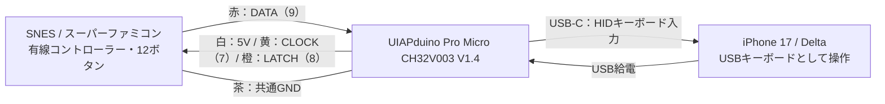

# SFCコントローラー用UIAPduino USBキーボード

SFC／SNESコントローラーの12ボタンを税込290円のUIAPduino V1.4で読み取り、USB HIDキーボードとして送るファームウェアです。iPhone 17のDeltaでGBAゲームの操作を確認しています。SELECTは**Tab**を送ります。

**ブレッドボード構成で、下記の動作検証を完了しています。** 全12ボタン、長押し・同時押し・部分解放、iPhoneのDeltaでの操作と再接続を確認しました。接続時保持・ロック復帰には [既知の制約](#既知の制約と使い方) があります。

通常版を書き込んだ別のUIAPduinoを、USB-Cケーブルを差した状態でコントローラー内部へ収納し、元のコントローラーケーブルは撤去しました。内蔵後の機械的な確認と入力・接続確認も問題ありませんでした（2026-11-11、製作者報告）。[収納構成](docs/hardware.md#内蔵用部材と写真) と、内蔵前の配線・導入手順を掲載しています。端末・ファームごとの [確認範囲](#確認した環境と範囲) を参照してください。

## はじめに

1. [必要な部品と確認済み構成](docs/hardware.md) を確認する。
2. [配線表](docs/wiring.md#接続表) に従い、USBを外して5本を接続する。
3. [導入手順](docs/getting-started.md) に従って通常版をビルド・書き込みする。
4. Macで入力を確認し、Deltaでキーを割り当てる。

開発・書き込み手順はmacOS向けです。このリポジトリではArduino CLIを使い、PlatformIO用のプロジェクト設定は提供していません。

## 機器構成図

SFCコントローラーとUIAPduinoをブレッドボード上で5本の配線により接続し、USB-CでiPhoneまたはMacへつなぎます。接続先のUSBからUIAPduinoへ給電し、UIAPduinoの5V端子からSFCコントローラーへ給電します。



括弧内の7・8・9はUIAPduinoの端子表示です。線色は今回のSFC個体のもので、詳しい番号対応は [配線表](docs/wiring.md#接続表) を参照してください。

## キー割り当て

| SFCボタン | USBキー | SFCボタン | USBキー |
| --- | --- | --- | --- |
| B | Z | A | X |
| Y | A | X | S |
| SELECT | **Tab** | START | Enter |
| 上 | 上矢印 | 下 | 下矢印 |
| 左 | 左矢印 | 右 | 右矢印 |
| L | Q | R | W |

Deltaでは遊ぶシステムごとに割り当てます。GBAの10入力は同名のSFCボタンを使い、SFCのX・Yはこの基本割り当てでは使用しません。SNESのX・Yを設定する場合も上表のキーを使用します。

出力は6キーまでです。7入力以上ではB → Y → SELECT → START → 上 → 下 → 左 → 右 → A → X → L → Rの順で先頭6個を採用し、解放で枠が空くと保持中の入力が戻ります。詳細は [統合版の仕様](docs/sfc-keyboard.md) を参照してください。

## 通常版をビルドする

プロジェクトのルートで実行します。初回はネットワークから固定版の開発環境を取得します。

```sh
bash scripts/setup_arduino.sh
bash scripts/build_firmware.sh sfc-keyboard
```

これらは基板への書き込みを行いません。引数を省略したビルドは診断用の全解放版 `neutral` になるため、通常使用では `sfc-keyboard` を指定します。

| 項目 | 現在の通常版 |
| --- | --- |
| ボード | UIAPduino V1.4、初期5V設定 |
| コア | `UIAP_HID:ch32v@1.2.15` の専用コピーに管理パッチを適用 |
| USB | Keyboard+Mouse（`usb=kbd`）。マウス操作は行わない |
| BIN / 静的RAM | 5,496 / 196バイト |
| 出力 | `.local/build/sfc-keyboard/snes_controller.ino.bin` |
| ファーム変更を含むコミット | `fb06b04` |

実機確認したBINのSHA-256：

```text
43a82eb36c7df4d298dd01f6b25460117fab0207c9206382b5eeaf92379a9079
```

依存物の固定・検証とFQBNは [ビルド詳細](docs/build.md)、変更したUSB処理は [管理パッチ](patches/README.md) に記録しています。

## 確認した環境と範囲

Mac・iPhoneの詳細試験は2026-11-10、内蔵後とiPadの確認報告は2026-11-11の記録です。以前のファームで行った試験と、現在のTab版で再確認した範囲を分けています。

| 環境・ファーム | 結果 |
| --- | --- |
| Mac / macOS 26.7.1 / Safari 27.0、先行Backspace通常版 | 全12キー、左右30秒以上、同時押し・部分解放、6→7→6入力をログで確認 |
| 同じMac、現在のTab通常版 | SELECT→Tabを3回、B→Zを1回、押下・解放をログで確認 |
| iPhone 17 / iOS 26.2 / Delta 1.7.3、現在のTab通常版 | GBA『シナモンふわふわ大作戦』でSELECTの登録・操作、斜め・3入力以上、右＋Bの部分解放、全解放での再接続3回を実機確認 |
| iPhoneの先行試験 | 全解放での再接続10回、USB-Cの向き4組などを確認。trace v1ではアプリ切り替え・全解放ロック復帰各3回、30分連続使用を実機確認 |
| 内蔵後、現在のTab通常版 | 絶縁・固定・干渉等、閉蓋後のボタン操作感、全入力・長押し・同時押し・再接続について問題なしとの製作者報告。30分連続使用、握り込み・ケーブル軽操作時の安定性も問題なし。長押し時間・再接続回数は未記録 |
| iPad Air（M2） / iPadOS 26.5 / Delta 2.0.1 | 動作確認済み |
| SNES | 旧版で設定画面の12入力を実機確認、実ゲームはROM未所持で未確認 |

30分連続使用は先行する計測版に加え、Tab通常版を搭載した内蔵後の構成でも問題ありませんでした。試験方法とファームごとの結果は [検証結果](docs/validation.md)、BIN識別とログのハッシュは [証跡一覧](docs/evidence/README.md) を参照してください。

## 既知の制約と使い方

- **全ボタンを離してUSBを接続してください。** 接続前から右を保持するとDeltaでは押し直しが必要な現象が未解決です。
- **ロック・アプリ切り替え前にも全ボタンを離してください。** 右を保持してロックし、ロック中に離すと復帰後に右が残る現象が未解決です。今回の事例では、Deltaを前面にして右を押し直し、離すと回復しました。
- **SELECTはTabへ割り当ててください。** iOS 26.2／Delta 1.7.3では、Backspaceは設定表示があっても入力が認識されませんでした。Delta 2.0.1でも同じ症状を確認し、[Issue #579](https://github.com/rileytestut/Delta/issues/579) として報告しています。[公開ソースの調査結果](docs/known-issues.md#delta-201の公開情報確認) も参照してください。
- 最小押下時間・高速入力の保証はありません。Delta上での6／7入力の挙動は未確認です。

接続時保持・ロック復帰の問題は未修正です。詳しくは [既知の問題と未確認事項](docs/known-issues.md) を参照してください。診断用の `sfc-keyboard-trace` はUSB応答時間に懸念があるため使用保留です。

## 開発・資料

```sh
bash tests/run_host_tests.sh
SNES_HOST_SANITIZERS=1 bash tests/run_host_tests.sh
```

ホストテストにはC++14対応のClangまたはGCCが必要です。実コアの試験やUSBの観測方法は [ビルド詳細](docs/build.md) を参照してください。

- [資料の案内](docs/publication.md) / [動作確認結果](docs/validation.md)
- [部品と確認済み構成](docs/hardware.md) / [導入手順](docs/getting-started.md)
- [配線と入力診断](docs/wiring.md) / [ファームウェア仕様](docs/sfc-keyboard.md)
- [開発記録・原因調査・引き継ぎ](docs/development/README.md)

本プロジェクトのソースと文書は [MIT](LICENSE) です。移植元の著作権表示を保持しています。ダウンロードするコア・ツール等の依存物には各々のライセンスが適用されます。ゲームROM、第三者製ソフトウェア、ローカルのビルド成果物・生ログは同梱していません。
