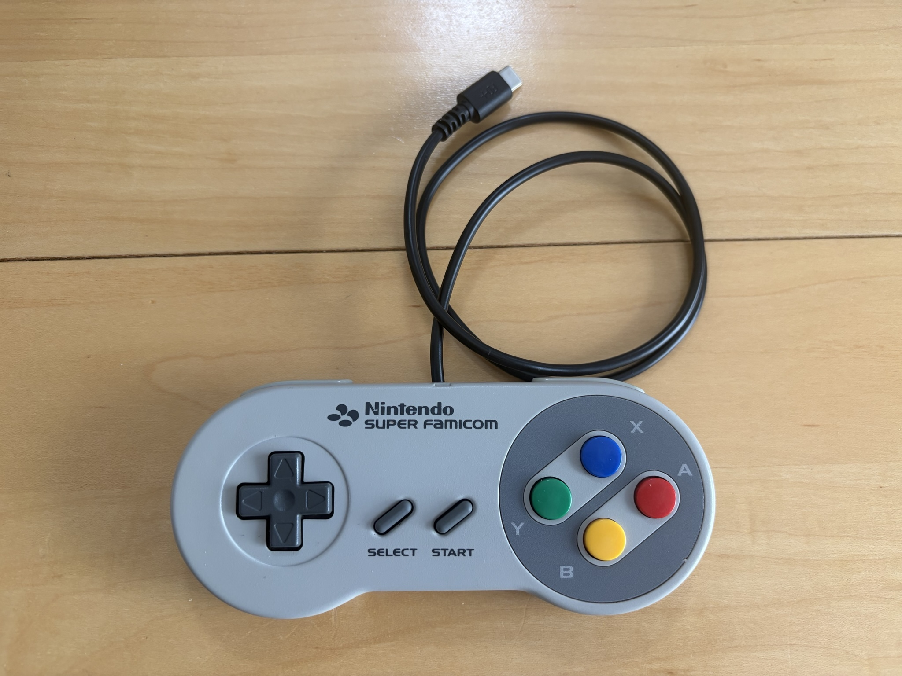
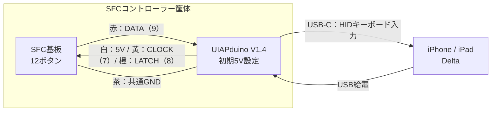

# SFCコントローラー用UIAPduino USBキーボード

SFC／SNESコントローラーにUIAPduino V1.4、USB-C to USB-C通信ケーブルを内蔵し、USB-CでiPhone／iPadのDeltaを操作するためのプロジェクト（ファームウェアを含む）です。
UIAPduino（税込290円）とUSB-Cケーブル（税込110円）の合計税込400円で、お手持ちのSFCコントローラーを12ボタンのUSB HIDキーボードとして使えるように改造できます。

USBから給電するため、電池やBluetoothのペアリングは不要です。内蔵した構成で入力・再接続・30分連続使用を確認しています。対応を確認した端末は [確認環境](#確認した環境と範囲)、接続時やロック時の注意点は [既知の制約](#既知の制約と使い方) を参照してください。

## はじめに

[](https://x.com/ot_it_bridge/status/2120432280246391145)

[筐体内部の配置写真](docs/hardware.md#内蔵用部材と写真) も掲載しています。[Xでのポスト（動画）](https://x.com/ot_it_bridge/status/2120432280246391145)

1. [必要な部品と内蔵構成](docs/hardware.md) を確認する。
2. [配線表](docs/wiring.md#接続表) に従い、USBを外して5本を接続する。
3. [導入手順](docs/getting-started.md) に従って配布バイナリを書き込む（ソースからのビルドも可能）。
4. Macで入力を確認し、Deltaでキーを割り当てる。
5. [内蔵時の確認事項](docs/hardware.md#内蔵用部材と写真) を確認し、ケースを閉じた状態でも動作を確認する。

書き込み手順はmacOS向けです。配布バイナリなら開発環境は不要です。ソースからビルドする場合はArduino CLIを使用します。

## ブラウザで動作確認

**[入力確認画面を開く](https://otitbridge.github.io/snes-controller-uiapduino/)**

全ボタンを離してUSB接続し、「記録を消して開始」を押すだけで、SFCコントローラーの配置に沿って12ボタンの押下・解放を確認できます。「キー名・保持時間を表示」で詳細も確認できます。サーバーの起動やインストールは不要です。画面を前面に保ち、コントローラーだけを操作してください。

入力ログはブラウザ内だけに保持し、「ログをダウンロード」で保存できます。ページを閉じると記録は失われます。Mac内へ自動保存したい場合は [ローカル記録手順](docs/getting-started.md#4-macで入力を確認する) を使用してください。

Mac・iPhone・iPadで、実物のSFCコントローラーを使った公開ページの動作を確認しています。[確認範囲](docs/validation.md#公開ページでの実機確認) を参照してください。

## 機器構成図

コントローラー内部のUIAPduinoとSFC基板を5本の配線で接続し、USB-CケーブルでiPhone／iPadへつなぎます。接続先のUSBからUIAPduinoへ給電し、UIAPduinoの5V端子からSFC基板へ給電します。



括弧内の7・8・9はUIAPduinoの端子表示です。線色は確認したSFC個体のもので、詳しい番号対応は [配線表](docs/wiring.md#接続表) を参照してください。

## キー割り当て

| SFCボタン | USBキー | SFCボタン | USBキー |
| --- | --- | --- | --- |
| B | Z | A | X |
| Y | A | X | S |
| SELECT | **Tab** | START | Enter |
| 上 | 上矢印 | 下 | 下矢印 |
| 左 | 左矢印 | 右 | 右矢印 |
| L | Q | R | W |

Deltaでは遊ぶシステムごとに割り当てます。GBAの10入力は同名のSFCボタンを使い、X・Yは使用しません。SNESでは上表の12入力を割り当てます。

同時出力は最大6キーです。7入力以上では固定の優先順で6キーを選び、解放で枠が空くと保持中の入力が戻ります。[優先順と動作例](docs/sfc-keyboard.md#同時押しと部分解放) を参照してください。

## ビルド済み通常版を使う

**[通常版をダウンロード（GitHub Releases）](https://github.com/otitbridge/snes-controller-uiapduino/releases/latest)**

`snes-controller-uiapduino-v1.0.0.zip`には実機確認済みのBIN、照合用ハッシュ、書き込みツールの準備スクリプト、手順、ソースとライセンスをまとめています。クローンやArduino環境の構築は不要です。展開後は[配布版の書き込み手順](releases/v1.0.0/README.md)に従ってください。対象はUIAPduino V1.4・初期5V設定です。

## 通常版をビルドする

プロジェクトのルートで実行します。初回はネットワークから開発環境を取得します。

```sh
bash scripts/setup_arduino.sh
bash scripts/build_firmware.sh sfc-keyboard
```

通常使用では `sfc-keyboard` を指定してください。これらのコマンドはビルドまでを行います。基板への書き込みは [導入手順](docs/getting-started.md)、依存ツールの版・成果物の照合は [ビルド詳細](docs/build.md) を参照してください。

## 確認した環境と範囲

| 端末・環境 | 確認内容 |
| --- | --- |
| Mac / macOS 26.7.1 / Safari 27.0 | キーボード入力の確認 |
| iPhone 17 / iOS 26.2 / Delta 1.7.3 | GBA『シナモンふわふわ大作戦』の操作・再接続 |
| iPad Air（M2） / iPadOS 26.5 / Delta 2.0.1 | 動作確認済み |

内蔵後の全入力・長押し・同時押し・再接続、30分連続使用、握り込み・ケーブルを軽く動かした際の安定性を確認しています。SNES実ゲームでの動作は未確認です。

試験条件・対象ファーム・確認方法は [検証結果](docs/validation.md) にまとめています。

## 既知の制約と使い方

- **全ボタンを離してUSBを接続してください。** 接続前から保持したボタンは、Deltaで押し直しが必要になる場合があります。
- **ロック・アプリ切り替え前にも全ボタンを離してください。** ロック中に離した入力が復帰後も残る場合があります。Deltaを前面にし、入力が残ったコントローラーのボタンを一度押して離すと回復した例があります。
- **SELECTはTabへ割り当ててください。** ファームウェアのSELECT出力はTabです。
- 最小押下時間・高速入力の保証はありません。Delta上での6／7入力の挙動は未確認です。

症状の確認環境、Backspaceの問題と回避策は [既知の問題](docs/known-issues.md) を参照してください。

## 開発・資料

- [資料の案内](docs/publication.md) / [動作確認結果](docs/validation.md)
- [部品と内蔵構成](docs/hardware.md) / [導入手順](docs/getting-started.md)
- [配線と入力診断](docs/wiring.md) / [ファームウェア仕様](docs/sfc-keyboard.md)
- [ビルド・テスト手順](docs/build.md) / [USBコアの管理パッチ](patches/README.md)
- [制作経緯・原因調査・引き継ぎ](docs/development/README.md) / [検証の証跡](docs/evidence/README.md)

本プロジェクトのソースと文書は [MIT](LICENSE) です。移植元の著作権表示を保持しています。コア・ツール等の依存物には各々のライセンスが適用されます。ゲームROM・生ログは同梱していません。GitHub Releasesでは通常版BINをソース・依存物のライセンスとともに配布します。
