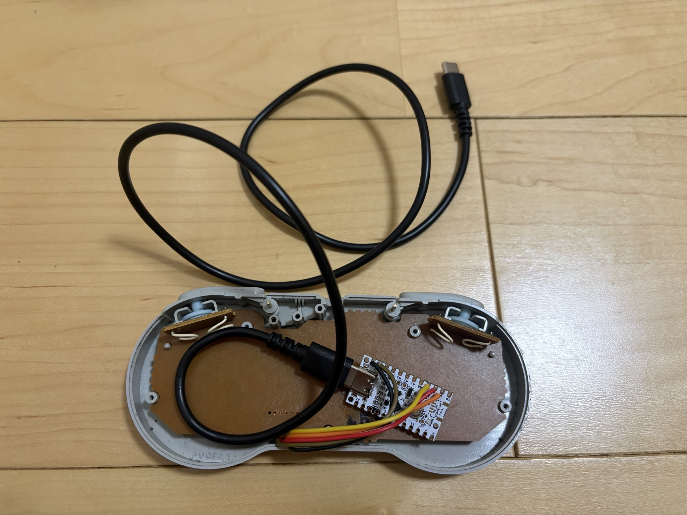

# 部品と確認済み構成

UIAPduinoを内蔵したSFCコントローラーの部品・配線と、製作時の確認事項をまとめています。動作確認の条件と結果は [検証結果](validation.md) を参照してください。

## 基板とケーブルの費用

| 部品 | 税込価格 |
| --- | ---: |
| UIAPduino V1.4 | 290円 |
| USB-Cケーブル（AT-PDCASTCC08） | 110円 |
| **合計** | **400円** |

使用した部品の購入価格です。合計は基板とUSB-Cケーブルの2点分で、コントローラー本体・工具・配線などの副資材は含みません。

## 必要な部品と機器

| 部品 | 数量 | 仕様・用途 |
| --- | --- | --- |
| UIAPduino | 1台 | V1.4、MCU電圧設定は初期5V |
| SFC／SNESコントローラー | 1台 | 有線タイプ。使用個体の正式型番・基板版は未記録 |
| 接続線 | 5本 | VCC、GND、CLOCK、LATCH、DATA |
| USB-Cケーブル | 1本 | データ通信対応。[確認済みケーブル](#確認済みのusbケーブル) を参照 |
| 固定・絶縁用の部材 | 必要量 | 筐体に合わせて用意。使用材料・加工寸法は未収録 |

ファームウェアの書き込みにはMacを使用します。[開発環境](build.md#開発環境) と [導入手順](getting-started.md) を参照してください。操作先はiPhone／iPadのDeltaです。確認済みの端末・OSは [READMEの確認環境](../README.md#確認した環境と範囲) に記載しています。

## 確認済みのUSBケーブル

| 製品 | 確認内容 |
| --- | --- |
| アットキュー AT-PDCASTCC08 | 掲載写真の内蔵構成で使用。内蔵後の動作・安定性を確認済み |
| セリアで販売の EM-69A | 2026-11-11、製作者から問題なく動作したとの報告あり |

EM-69Aの報告範囲は [追加ケーブルの動作確認](validation.md#追加ケーブルの動作確認) を参照してください。上記の費用表と掲載写真はAT-PDCASTCC08を使用した構成です。

## 5本の配線

USBを外して配線します。他のマイコンに接続されている信号線は切り離し、同じ信号線を複数のマイコンで同時に駆動しないでください。

| SFC信号 | 本個体の基板番号・線色 | UIAPduino V1.4の端子表示 |
| --- | --- | --- |
| VCC | 5・白 | **5V電源端子** |
| GND | 1・茶 | GND |
| CLOCK | 4・黄 | 7（PC5） |
| LATCH | 3・橙 | 8（PC6） |
| DATA | 2・赤 | 9（PC7） |

白線の接続先はGPIOの「5」ではなく、電源の「5V」です。SFC基板の番号とUIAPduinoの表示番号は別の付番です。

この基板番号・線色は動作確認した個体の情報です。番号・線色は実機操作者の申告に基づきます。すべてのSFCコントローラーで共通とは扱いません。掲載写真は内蔵配置を示すもので、SFC基板の各接続点と番号の対応を照合できる接写や、導通・電圧の実測記録はありません。内蔵用の接続線の色を、この表の元ケーブルの線色と同一視しないでください。電圧設定を変更した場合は同じ条件として扱わず、信号と電源を確認してください。外部コネクター番号との違い、出典、通電前の確認は [配線詳細](wiring.md) にまとめています。

## 内蔵用部材と写真

UIAPduinoをUSB-Cケーブル接続状態で筐体内へ収め、元のコントローラーケーブルは撤去した構成です。

ケースを開いた状態の配置です。写真ではUIAPduinoへのUSB-C接続、内部のケーブルの取り回し、筐体上部からの引き出しを確認できます。[ケースを閉じた完成外観](images/controller-exterior.jpg) も掲載しています。写真だけでは基板裏側の絶縁や固定強度までは確認できません。

掲載写真の内蔵構成で使用したケーブルはアットキューの **AT-PDCASTCC08** です。[メーカー製品ページ](https://atq.amebaownd.com/posts/53888832?categoryIds=2712238) では、USB Type-Cオス同士、約70cm、USB 2.0通信（最大480Mbps）、PD充電最大60W対応とされています。本構成ではUSBからの5V給電とデータ通信に使用します。

製作時は次を確認してください。

- 基板・はんだ接合部を絶縁し、筐体内で動かないよう固定する。
- ボタン・導電ゴム・ねじと干渉せず、配線を挟み込まないようにする。
- ケーブルを引く力が基板やUSB端子へ直接かからないよう保持する。
- ケースを閉じた状態で、ボタンの戻り・全入力・再接続を確認する。
- 再書き込み時にUSB端子とRESETへアクセスする方法を確保する。

内蔵後の入力・接続・30分連続使用と、握り込み・ケーブル軽操作時の安定性は確認済みです。[内蔵後の検証結果](validation.md#内蔵用の別基板) を参照してください。固定具・絶縁材・ケーブル保持・加工寸法の詳細は未収録です。再書き込み用アクセスの実物確認も未記録です。
